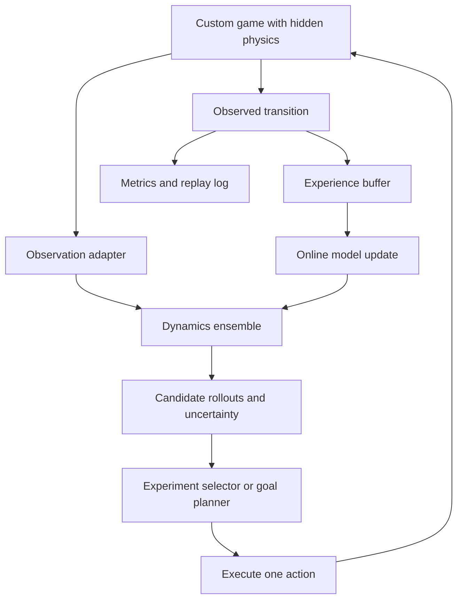

# TaklaToon

**An AI agent that learns unfamiliar game physics through active experimentation.**

TaklaToon observes movement, tries informative actions, learns a model of the game's dynamics, and uses that model to plan toward a goal. The first implementation will operate inside small, custom-built 2D games with hidden gravity, surface drag, and jump strength.

> **Project status:** proposal and implementation guide. This README describes what the team will build. It does not claim that the agent, game environments, training scripts, or performance results already exist. The setup smoke test below uses an existing Gymnasium environment; the project commands and repository structure are proposed interfaces.

## Contents

- [1. Project overview](#1-project-overview)
- [2. Scope and first milestone](#2-scope-and-first-milestone)
- [3. Games and environments we will test](#3-games-and-environments-we-will-test)
- [4. Technologies and responsibilities](#4-technologies-and-responsibilities)
- [5. System architecture](#5-system-architecture)
- [6. Environment and action design](#6-environment-and-action-design)
- [7. Rewards and learning signals](#7-rewards-and-learning-signals)
- [8. Dataset collection](#8-dataset-collection)
- [9. World model implementation](#9-world-model-implementation)
- [10. Planning and active experiments](#10-planning-and-active-experiments)
- [11. Training and adaptation loop](#11-training-and-adaptation-loop)
- [12. Development roadmap](#12-development-roadmap)
- [13. Evaluation and baselines](#13-evaluation-and-baselines)
- [14. Proposed repository structure](#14-proposed-repository-structure)
- [15. Local setup](#15-local-setup)
- [16. Proposed configuration and commands](#16-proposed-configuration-and-commands)
- [17. Testing and debugging](#17-testing-and-debugging)
- [18. Team workflow](#18-team-workflow)
- [19. Demo and deliverables](#19-demo-and-deliverables)
- [20. Risks, applications, and extensions](#20-risks-applications-and-extensions)
- [21. References](#21-references)

## 1. Project overview

### The problem

A controller trained for one set of movement rules may struggle when those rules change. A jump that worked before might fall short under stronger gravity. A braking action might fail on a slippery floor.

TaklaToon will investigate whether an agent can adapt more efficiently by deliberately choosing actions that reveal useful information about the new movement dynamics.

### What the system will do

1. Enter a supported game environment with known controls but hidden physics values.
2. Observe its position, velocity, contacts, and relevant level geometry.
3. Predict what several possible actions would do.
4. Choose short experiments when the movement rules are uncertain.
5. Update its learned dynamics model from actual observations.
6. Plan and execute actions toward the goal.
7. Record what it tried, what it predicted, and whether it succeeded.

### Project classification

This is an **applied AI/ML project with an experimental research component**. The applied deliverable is a working adaptive game agent and testing environment. The research question is whether informative probes improve adaptation compared with random probes under the same interaction budget.

We will use established methods first. A new algorithm or a statistically convincing performance improvement would require additional evidence before claiming a research contribution.

### A short explanation for someone else

> We are building an agent that learns how an unfamiliar game moves by experimenting. It tries movements and jumps, compares predicted motion with actual motion, and updates a small world model. It then uses that model to plan toward the goal. We will test whether deliberate experiments help it adapt faster than random exploration.

## 2. Scope and first milestone

### Included in the first version

- One custom 2D game family with progressively harder levels.
- Known, fixed controls and visible static level geometry.
- Direct state observations from the game engine.
- Hidden physics parameters that stay constant during each initial evaluation run.
- A learned dynamics model, online adaptation, and a short-horizon planner.
- Reproducible experiments and a visual demonstration.

### Later work

Raw screenshots, arbitrary commercial games, moving platforms, portals, complex object interactions, and changing physics in the middle of a run are extensions. They introduce additional perception, modelling, or planning problems.

### First milestone

**Build one flat floor and one gap. Let the agent observe jumps under hidden gravity, update its predictions, and attempt to cross the gap.**

Before adding active exploration, verify that a model can learn motion and that a planner can use accurate predictions. A deliberately chosen experiment is useful only if the modelling and control pipeline already works.

## 3. Games and environments we will test

Our primary evidence will come from environments we build and can instrument. These are small games, not integrations with existing commercial titles.

| Environment | Task | Hidden changes | Purpose | Priority |
|---|---|---|---|---|
| **MotionLab** | Accelerate and stop inside a target zone on a flat track | Horizontal drag; later acceleration strength | Debug data collection, prediction, and braking | Build first |
| **JumpLab** | Jump from a fixed launch area onto a platform | Gravity and jump impulse | Learn vertical motion and landing outcomes | Core milestone |
| **GapRunner** | Cross a gap and reach a flag | Gravity, jump impulse, and drag combinations | Main adaptation benchmark and presentation demo | Core |
| **SurfaceShift** | Reach a target across surfaces with different stopping behaviour | Material-dependent drag | Test local mechanics after the basic model works | Second stage |
| **BounceLab** | Use a spring pad to reach a platform | Bounce response | Test an additional contact mechanic | Optional |
| **Pendulum-v1** | Swing up and stabilize a pendulum | Gravity variations across instances | Optional smooth-dynamics sanity benchmark | Optional |

The official [Gymnasium Pendulum environment](https://gymnasium.farama.org/environments/classic_control/pendulum/) exposes a gravity setting. It is a control benchmark rather than the project's platform game. It uses continuous torque actions, so it needs a separate action adapter and planning sampler. Test it independently; do not claim a platform-game checkpoint automatically transfers to it.

### Level progression

1. Flat floor, no hazards, one goal.
2. One jump with a wide landing platform.
3. One gap with a fixed launch area.
4. Multiple launch positions and gap widths.
5. New layouts combined with held-out physics settings.
6. Different surface materials, followed by optional bounce mechanics.

### Parameter design

Choose a reference gravity, jump impulse, and drag after manually testing the game. Store variations as explicit multipliers or documented coefficients. A preliminary gravity or jump range of approximately **0.8–1.2 times a reference value** can help debug adaptation, but it is a proposed starting range, not a benchmark standard.

Ensure each scored task is physically solvable. Use the actual simulator and a reference controller to check feasibility. Keep intentionally impossible tasks in a separately labelled diagnostic set.

For SurfaceShift, expose the visible material category or local map feature but hide its drag coefficient. Unmarked, changing materials would create a different partial-observation problem.

## 4. Technologies and responsibilities

| Tool | What we will use it for | Important boundary |
|---|---|---|
| **Python** | Main project language and experiment orchestration | Keep the first implementation in one language |
| **Pygame** | Game window, manual controls, sprites, overlays, and replay | Rendering must not determine simulation speed |
| **Pymunk** | Rigid-body simulation, gravity, contacts, and collision handling | It runs the real game physics, not the learned model |
| **Gymnasium** | A consistent environment API with observations, actions, reset, and step | Enables repeatable experiments and baseline integration |
| **PyTorch** | Dynamics networks, training, checkpoints, and online updates | Start with small multilayer perceptrons |
| **NumPy** | Data handling, candidate sampling, and planning utilities | Vectorize candidate evaluation where possible |
| **Stable-Baselines3** | Optional PPO baseline | It does not implement the proposed active world-model controller for us |
| **TensorBoard** | Training curves, prediction errors, and run comparison | Also save raw metrics independently |
| **pandas + Matplotlib** | Evaluation tables and plots | Plot measured results only |
| **pytest** | Environment and learning-pipeline checks | Prioritize correctness and reproducibility |
| **YAML** | Physics settings, training settings, and evaluation configurations | Configurations must accompany results |
| **Git** | Version control and team collaboration | Track source and configs, not large generated datasets |
| **VS Code or another editor** | Development and debugging | Editor choice does not affect the method |

Pymunk supplies Python interfaces for 2D physics. Gymnasium defines the environment contract. PyTorch supplies model-training primitives. Stable-Baselines3 supports custom Gymnasium environments for baseline agents. See the [Pymunk API](https://www.pymunk.org/en/latest/pymunk.html), [Gymnasium environment guide](https://gymnasium.farama.org/introduction/create_custom_env/), [PyTorch tutorials](https://docs.pytorch.org/tutorials/beginner/basics/intro.html), and [SB3 custom-environment guide](https://stable-baselines3.readthedocs.io/en/master/guide/custom_env.html).

**No LLM API, cloud service, database, Unity project, or web frontend is required for the MVP.** Streamlit can be an optional results viewer after the Pygame demo works.

## 5. System architecture



### Essential distinction

**Pymunk knows the true physics because it simulates the game. TaklaToon must infer useful motion predictions from observations.**

The learner must not call the real simulator to evaluate imagined candidate actions. Otherwise, it would be planning with true dynamics rather than demonstrating learned physics. Only a separately labelled oracle baseline may do that.

## 6. Environment and action design

### Gymnasium interface

The environment will implement:

```python
observation, info = env.reset(seed=seed)
next_observation, reward, terminated, truncated, info = env.step(action)
frame = env.render()
env.close()
```

Use `terminated` for actual task outcomes such as reaching the goal or falling. Use `truncated` for a time limit. Preserve this distinction in datasets and baseline training.

### Observations

For the first version, provide a fixed-size numeric observation containing:

- Character position and horizontal/vertical velocity.
- A grounded flag and necessary contact information.
- Relative goal position.
- Relative bounds of a small, fixed number of relevant platforms, plus padding masks.
- Visible local surface category when SurfaceShift is introduced.

Use consistent units and document them. Normalize features using statistics from training data; reuse those statistics for validation and testing.

Do not expose gravity, drag coefficients, jump impulse, a dynamics preset identifier, future simulator states, or a level ID that encodes hidden physics. The evaluator can store them in a separate metadata record that the agent never receives.

### Initial discrete controls

| ID | Action |
|---|---|
| 0 | No input |
| 1 | Move left |
| 2 | Move right |
| 3 | Jump |
| 4 | Move left and jump |
| 5 | Move right and jump |

Allow a jump only when grounded. Define whether holding a jump action can retrigger it after landing. Keep this behaviour consistent across collection, prediction, and evaluation.

### Time stepping

A reasonable initial engineering choice is **30 control steps per second**, each with **four physics substeps at 1/120 second**. These are proposed settings to verify with the simulator, not required library defaults.

One `env.step()` represents one control decision. Count it once in the interaction budget. Never multiply gravity or impulses by rendering frame rate. Headless training and displayed play must use the same underlying simulation steps.

### Drag versus friction

Choose one clearly defined horizontal stopping mechanism first. For example, implement documented linear drag on grounded horizontal motion. Do not silently mix a custom damping law, Pymunk surface friction, and global damping while describing all of them as one hidden parameter. Complex friction can be added after the basic model is reliable.

## 7. Rewards and learning signals

We will use three separate signals, each for a different purpose.

| Signal | Purpose | Where it acts |
|---|---|---|
| **Task reward** | Define successful gameplay | Planner scoring and PPO training |
| **Prediction loss** | Teach the model to predict observed motion | PyTorch model optimization |
| **Exploration bonus** | Prefer potentially informative experiments | Probe selection |

### Proposed task rewards

| Event | Illustrative starting value |
|---|---:|
| Reach the goal | +100, once, then terminate |
| Fall into a hazard | -20, once, then terminate |
| Each control step | -0.01 |
| Progress shaping | Optional, with a documented formula |

These are tunable design choices. Begin with the same reward function for every compared method.

If sparse rewards make planning difficult, introduce potential-based shaping:

```text
shaping = scale × (gamma × potential(next_state) - potential(current_state))
```

Choose a bounded potential based on distance or route progress. Use the same discount factor consistently. Set terminal potential appropriately for true terminal states, and handle time-limit truncation separately. Validate the implementation before assuming it preserves the intended objective.

Do not reward only positive movement while ignoring backward movement. That can allow repeated reward collection without completing the task. Plot where rewards arise and compare shaped scores with actual completion rates.

### Model loss

The model receives supervised targets from real transitions. It can improve its predictions even when an attempted jump fails. A failed action may provide useful data while still earning a negative task reward.

### Exploration bonus

Ensemble disagreement provides a practical proxy for model uncertainty. It is not guaranteed information gain and should not grow forever. Reduce the bonus as the probe budget runs out and avoid repeatedly selecting obviously failing actions solely because they are uncertain.

## 8. Dataset collection

We do not need a downloaded gameplay dataset for the core MVP. We will generate transitions from our own simulator.

### Transition record

Store at least:

```text
observation, action, next_observation, reward,
terminated, truncated, episode_id, timestep, seed
```

Store physics settings, map definitions, software versions, and collection-policy details separately as evaluator metadata. Never concatenate hidden parameters into model inputs accidentally.

### Collection strategy

1. Record reproducible manual-control trajectories to debug movement.
2. Add scripted probes: accelerate, release, short jump, and stationary jump.
3. Add random action sequences with a mixture of short holds and releases.
4. Vary physics across episodes and collect takeoff, airborne, landing, and braking transitions.
5. Check coverage rather than relying on a large dataset of idle frames.

Start with approximately **10,000 transitions** for pipeline debugging. Increase the dataset after measuring held-out error and contact-event coverage. This is a starting budget, not a claim that 10,000 transitions will solve the games.

### Data split

- Separate whole trajectories and seeds for training and validation.
- Reserve complete physics combinations and map layouts for the final test set.
- Fit preprocessing only on training data.
- Save a split manifest so every method uses the same task definitions.
- Avoid splitting adjacent frames randomly across training and validation.

## 9. World model implementation

### Start small

Implement one multilayer perceptron before an ensemble. A proposed starting network is:

```text
Normalized state + one-hot action + relevant geometry
    -> Linear(128) -> ReLU
    -> Linear(128) -> ReLU
    -> Predicted kinematic change
```

Predict changes in position and velocity rather than rendering the next image. Known static geometry can be carried forward unchanged. Handle contacts explicitly: start with simple floor interactions, then assess whether a contact-prediction head or a documented geometric projection is necessary.

If we add a hybrid geometric correction, describe it in the report and apply it consistently across model-based comparisons. It must not use hidden physics coefficients.

### Suggested initial training settings

| Setting | Starting proposal |
|---|---|
| Optimizer | Adam |
| Learning rate | 0.001 |
| Batch size | 256 |
| Hidden layers | Two layers of 128 units |
| Ensemble size | Five, after one model works |
| Core loss | Normalized prediction MSE |
| Checkpoint selection | Validation prediction error and rollout quality |

All settings require testing. Tune on validation tasks, not on final held-out test tasks.

### Why an ensemble?

Train several independently initialized models on bootstrap samples of the data. Compute their mean motion prediction and disagreement. This follows the general uncertainty-aware model-based-control direction of [PETS](https://arxiv.org/abs/1805.12114), but the proposed deterministic ensemble is a simplified implementation, not a full reproduction of PETS.

### Hidden dynamics make observations ambiguous

The same position, velocity, and action can lead to different outcomes under different hidden physics. Pooling all tasks into one context-free network may produce an average prediction that is wrong for each individual task.

Use online adaptation as the first solution: start from a shared pretrained checkpoint, then update using the current task's recent transitions. If this cannot specialize reliably, add a short transition history or a learned context encoder. Any context must come from observations, not ground-truth physics labels.

### Online adaptation

- Use a small recent-experience buffer.
- Compare recent-only updates with a mixture of recent and older training samples.
- Bound update steps and measure their wall-clock cost.
- Preserve independent ensemble members.
- Reset to the same pretrained checkpoint before each independent evaluation run.
- Record prediction error before fitting on that transition.

## 10. Planning and active experiments

### First planner: random shooting

Implement a simple planner before CEM:

1. Sample candidate action sequences.
2. Roll them forward through the learned models.
3. Estimate task reward, goal progress, and failure risk.
4. Select the best candidate.
5. Execute only its first action in the real environment.
6. Observe the result and replan.

Start with a short horizon and inspect predicted trajectories visually. Increase the horizon only after the model gives useful multistep predictions. A distant sparse goal may require a progress heuristic, waypoints, or a longer horizon.

### CEM upgrade

For the MVP's discrete controls, use a **categorical CEM distribution at each horizon position**. Select elite sequences, update action probabilities with smoothing, and repeat. A continuous Gaussian CEM implementation cannot directly represent these action IDs correctly.

For an optional continuous-action benchmark such as Pendulum, implement a separate bounded continuous sampler.

Proposed initial planner settings:

```yaml
planner:
  method: random_shooting  # upgrade to categorical_cem later
  horizon: 15
  candidates: 128
  cem_iterations: 3
  elite_fraction: 0.10
```

At 30 control steps per second, 15 steps cover about half a second. This may be insufficient for an entire jump. Adjust using measured rollout accuracy and solve quality. These values are placeholders to benchmark, not a performance promise.

### Experiment selection

During the exploration phase, score short candidate probes using:

```text
probe_score = uncertainty_weight × normalized_ensemble_disagreement
            + task_weight × expected_task_progress
            - risk_weight × predicted_failure_cost
```

Normalize disagreement by feature scale so position units do not dominate velocity units. Treat model disagreement as a heuristic; check whether high-disagreement probes actually improve later predictions.

Use the same candidate-generation and planning budget when comparing active and random probing where practical. Log any compute differences.

### Solving phase

After the initial probe budget, reduce the uncertainty bonus and emphasize task completion. Continue updating from observed transitions. The first evaluation protocol should use a fixed phase boundary for clarity. Adaptive exploration triggers can be a later ablation.

## 11. Training and adaptation loop

The following is **conceptual pseudocode**, not an implemented API:

```text
OFFLINE DEVELOPMENT
    build and validate the environment
    collect trajectories across training physics settings
    fit normalization on training data
    train the dynamics model, then the ensemble
    validate predictions and planning on development tasks
    save the base checkpoint and configuration

FOR EACH INDEPENDENT HELD-OUT RUN
    restore the base checkpoint and reset the task with its seed
    clear task-specific experience
    for each allowed real interaction:
        read the observable state
        sample candidate actions or short sequences
        predict outcomes using only the learned model
        choose a probe or a goal-directed action
        record the prediction before observing the result
        execute one real action and log its outcome
        add the transition to the task buffer
        update the model within the allowed compute budget
        handle termination or an allowed reset
    save metrics, replay, config, and checkpoint provenance
```

A simulation step used for a real probe counts toward the budget even if the action fails or the run resets. Offline training is a separate cost and must be reported.

## 12. Development roadmap

The schedule below assumes an approximately eight-week student project. Use milestones rather than treating the dates as guaranteed delivery times.

| Stage | Work | Exit criterion |
|---|---|---|
| **Week 1: game foundation** | MotionLab, fixed timestep, manual controls, configurable physics | Repeatable scripted motion and working reset |
| **Week 2: environment and data** | Gymnasium adapter, transition logger, JumpLab | Environment checks pass and dataset is readable |
| **Week 3: prediction model** | Normalization, one MLP, train/validation split | Predictions outperform a simple persistence baseline |
| **Week 4: planning** | Random-shooting MPC, wide landing targets, GapRunner | Planner can use a good model to complete development tasks |
| **Week 5: uncertainty** | Five-model ensemble and disagreement logging | Inspectable, non-identical predictions and stable training |
| **Week 6: active adaptation** | Recent buffer, online updates, informative probes | End-to-end explore/update/solve loop and random-probe ablation |
| **Week 7: evaluation** | Frozen-model and optional PPO baselines, held-out runs | Comparable seeded results with budgets recorded |
| **Week 8: demo and report** | Overlays, replay, plots, failure analysis | Reproducible demonstration and honest final conclusions |

If time is short, finish MotionLab and GapRunner with random-probe and frozen-model comparisons. SurfaceShift, BounceLab, PPO, and pixel input can wait. Do not remove the core comparison merely to add more game mechanics.

## 13. Evaluation and baselines

### Main hypothesis

> Under matched real-interaction budgets, selecting informative probes may improve task success or reduce interactions to success compared with random probing.

This is a hypothesis to test. A negative or mixed result is still reportable.

### Required comparisons

| Method | Purpose |
|---|---|
| Active probes + online ensemble + MPC | Proposed full system |
| Random probes + same online ensemble + MPC | Isolate experiment selection |
| Frozen ensemble + MPC | Isolate online model updates |
| Simple hand-designed probes + model + MPC | Check whether a simple experiment routine is already sufficient |
| Analytical parameter-fitting baseline, where feasible | Check whether small known physics families need a neural model at all |
| PPO from Stable-Baselines3, optional | Additional model-free reference |
| Oracle planner with true simulator dynamics, optional | Reference ceiling, clearly separate from fair learned-model comparisons |

Do not assume a neural model will outperform an analytical estimator on simple ballistic motion. This comparison helps identify where the learned approach adds value.

### Initial evaluation protocol

- Start debugging with a few configurations and seeds.
- For a fuller initial experiment, propose **20 held-out configurations × 5 seeds per method**.
- Allow **1,000 real control steps per run**, including an initial **200-step probe phase** and the remaining task-solving steps.
- Stop or handle resets under the same predefined rules for every method.
- Count time to first success from the start of the run, including probes.
- Reset model weights between independent runs; adaptation within a run is allowed.
- Use identical task definitions, initial-state seeds, and reset access.
- Report online computation and offline training interactions separately.
- Test novel parameter combinations within supported ranges first. Report extrapolation outside training ranges separately.

These are proposed budgets. Lock them after validation and before final testing. Match the base checkpoint for the active/random/frozen ablations. For PPO, document its training interaction cap and whether test-time learning is allowed; it does not consume an identical supervised dataset in the same way.

### Metrics

| Metric | Definition |
|---|---|
| Success rate | Fraction of evaluation runs that reach the goal within budget |
| Interactions to first success | All real actions before first completion, including probes |
| Prediction error | Pre-update normalized motion error on newly observed transitions |
| Failure count | Falls or deaths per run |
| Multistep rollout error | Prediction error after a fixed number of imagined steps |
| Adaptation benefit | Difference before and after a fixed probe budget |
| Planning/update latency | Time per decision and model update |
| Training cost | Offline transitions, wall time, and hardware |

Report failures alongside successful runs. If no success occurs, record the run as unsuccessful or censored at the budget; do not compute time-to-success only on successful runs without disclosing that selection. Report per-task results, aggregate results, and variability across seeds. Do not select only the best seed for the report.

## 14. Proposed repository structure

This is the directory structure to create during implementation. These modules are **not supplied by this README**.

```text
TaklaToon/
├── README.md
├── pyproject.toml
├── requirements-lock.txt
├── .gitignore
├── configs/
│   ├── environment.yaml
│   ├── training.yaml
│   └── evaluation.yaml
├── src/
│   └── taklatoon/
│       ├── __init__.py
│       ├── envs/
│       │   ├── base.py             # Gymnasium interface
│       │   ├── physics.py          # Real simulation, hidden parameters
│       │   ├── observations.py     # Learner-visible features
│       │   ├── rewards.py
│       │   └── levels.py
│       ├── models/
│       │   ├── dynamics.py
│       │   ├── ensemble.py
│       │   └── normalization.py
│       ├── planning/
│       │   ├── shooting.py
│       │   ├── categorical_cem.py
│       │   └── scoring.py
│       ├── exploration/
│       │   └── probes.py
│       ├── training/
│       │   ├── buffer.py
│       │   ├── offline.py
│       │   └── adaptation.py
│       ├── evaluation/
│       │   ├── runner.py
│       │   ├── baselines.py
│       │   └── metrics.py
│       └── demo/
│           ├── renderer.py
│           └── replay.py
├── scripts/
│   ├── manual_play.py
│   ├── collect_data.py
│   ├── train_model.py
│   ├── evaluate.py
│   └── run_demo.py
├── tests/
├── assets/
├── data/                         # Generated locally, usually ignored
├── checkpoints/                  # Generated locally
└── runs/                         # Configs, metrics, plots, and replays
```

Keep simulator internals separate from the learner. A clean `observations.py` boundary makes accidental parameter leakage easier to detect.

## 15. Local setup

### Hardware expectations

A laptop CPU is an appropriate starting point for manual play, environment development, and small-network debugging. A GPU can accelerate larger experiments, but speed must be measured on the actual implementation. Avoid claiming real-time performance until planning and update latency are measured.

### Windows setup

Install a compatible Python version first. **Python 3.11** is a proposed conservative starting choice. From the future repository root:

```powershell
py -3.11 -m venv .venv
.\.venv\Scripts\python.exe -m pip install --upgrade pip
.\.venv\Scripts\python.exe -m pip install torch "gymnasium[classic-control]" pygame pymunk numpy pandas matplotlib tensorboard pyyaml pytest
```

For the optional PPO baseline:

```powershell
.\.venv\Scripts\python.exe -m pip install stable-baselines3
```

These are setup instructions, not a verified project installation. Resolve compatible releases together and record the actual environment after the smoke test passes. Use the official [PyTorch installation selector](https://pytorch.org/get-started/locally/) if you want GPU support. Check the current [SB3 installation requirements](https://stable-baselines3.readthedocs.io/en/master/guide/install.html) before adding that optional dependency.

After verifying the environment:

```powershell
.\.venv\Scripts\python.exe -m pip freeze > requirements-lock.txt
```

Record Python version and operating system as well. A frozen dependency list helps reproduce an environment but does not guarantee portability across operating systems or GPU configurations.

### Standalone dependency smoke test

Save the following as `smoke_test.py`. It uses an existing Gymnasium environment and does not depend on TaklaToon modules:

```python
import gymnasium as gym
import numpy as np
import pygame
import pymunk
import torch

env = gym.make("Pendulum-v1", g=9.81)
observation, info = env.reset(seed=42)
env.action_space.seed(42)

for _ in range(10):
    observation, reward, terminated, truncated, info = env.step(
        env.action_space.sample()
    )
    assert np.isfinite(observation).all()
    if terminated or truncated:
        observation, info = env.reset()

env.close()
print("Dependency smoke test passed. CUDA available:", torch.cuda.is_available())
```

Run it with:

```powershell
.\.venv\Scripts\python.exe smoke_test.py
```

This checks imports and a basic environment interaction. It does not validate the future TaklaToon implementation.

## 16. Proposed configuration and commands

### Example configuration

This is a proposed configuration schema. The loader and its validation must be implemented.

```yaml
seed: 42

environment:
  task: gap_runner
  control_hz: 30
  physics_hz: 120
  observation_mode: state
  action_space: discrete_6
  reveal_hidden_parameters: false

model:
  hidden_sizes: [128, 128]
  ensemble_size: 5
  learning_rate: 0.001
  batch_size: 256
  predict_state_delta: true

planner:
  method: random_shooting
  horizon: 15
  candidates: 128

adaptation:
  total_control_steps: 1000
  probe_control_steps: 200
  update_interval: 5
  gradient_steps_per_update: 5

evaluation:
  split: held_out
  configurations: 20
  seeds_per_configuration: 5
  reset_model_between_runs: true
```

Online update frequency and step counts are starting proposals. Benchmark quality and latency before locking them.

### Target CLI

**The commands below will work only after the corresponding scripts are implemented.** They describe the interface the team should aim to build, not commands available in the current deliverable.

```powershell
# 1. Inspect the game manually
python scripts/manual_play.py --config configs/environment.yaml

# 2. Generate training transitions
python scripts/collect_data.py --config configs/training.yaml

# 3. Fit the world model or ensemble
python scripts/train_model.py --config configs/training.yaml

# 4. Run fair comparisons
python scripts/evaluate.py --config configs/evaluation.yaml

# 5. Display the agent and its predictions
python scripts/run_demo.py --config configs/evaluation.yaml
```

Use the activated virtual environment, or replace `python` with the explicit virtual-environment interpreter. Implement one shared config parser rather than allowing each script to interpret settings differently.

## 17. Testing and debugging

### Environment checks

- The same seed and action sequence reproduces a trajectory within documented numeric tolerance on the same setup.
- Reset clears velocity, contact state, counters, and previous-episode data.
- Rewards and terminal signals fire correctly and only once.
- Observation shapes and dtypes match declared spaces.
- Hidden parameters never appear in learner observations or accessible planner metadata.
- Grounded jump rules are consistent.
- Rendering does not change physics results.
- A known-solvable level can be completed by a reference controller.

Run Gymnasium's environment checker and, if using PPO, Stable-Baselines3's checker. They check interface issues, not the scientific validity of the experiment.

### Model checks

- Verify normalization and inverse transforms.
- Overfit a tiny trajectory as a debugging check.
- Compare against a persistence predictor before training a large ensemble.
- Inspect predicted versus actual motion over multiple steps.
- Examine contact transitions separately from airborne transitions.
- Check that bootstrap models do not accidentally share the same parameters or optimizer.
- Save and reload a checkpoint and reproduce its predictions.

### Planner checks

- Verify action bounds and discrete action IDs.
- Stop scoring after predicted termination rather than collecting the goal reward repeatedly.
- Confirm imagined rollouts never invoke the real simulator in the learned-model method.
- First test with an oracle model to separate planner bugs from model errors.
- Check that idle behaviour and back-and-forth movement cannot exploit rewards.
- Compare controller quality and latency before increasing horizon or candidate count.

### Common failure modes

| Symptom | Likely issue | First check |
|---|---|---|
| Agent keeps jumping in place | Reward or probe bonus encourages repetition | Inspect reward components and exploration schedule |
| Predicted jumps pass through floors | Contact modelling is inadequate | Review landing transitions and collision assumptions |
| Offline error is low but planning fails | Small model errors compound or validation is too similar | Inspect long rollouts and trajectory-level splits |
| Active probing loses to random probing | Disagreement is unhelpful or probes are too risky | Measure actual prediction improvement after each probe |
| Performance changes with FPS | Simulation depends on rendering timing | Fix the timestep and separate rendering |
| Adaptation hurts previously learned motion | Online updates overfit a narrow recent buffer | Reduce update count and test mixed replay |
| Test scores are unusually strong | Possible hidden-parameter or checkpoint leakage | Audit observations, metadata, and run reset logic |

## 18. Team workflow

Assign responsibilities by interface rather than creating separate incompatible systems.

| Workstream | Owns | Agrees on with the rest of the team |
|---|---|---|
| Environment and game | Physics, levels, observations, manual controls | State/action schema, timestep, reward definition |
| Learning and planning | Dataset pipeline, world model, MPC, probes | Transition format, checkpoint format, latency budget |
| Evaluation and demo | Baselines, metrics, plots, replay, presentation | Split manifest, seed list, budgets, report format |

A small team can combine these roles. Hold a short integration check after each milestone and demonstrate one end-to-end run.

Use branches for changes, review interface modifications together, and commit small working increments. Each experiment should identify:

```text
run_id, method, commit, config, seed, task,
training_checkpoint, training_cost, test_budget,
success, steps_to_success, failures, prediction_error,
planning_latency, update_latency
```

Keep `.venv/`, large datasets, checkpoints, and generated runs out of normal source commits. Share necessary artifacts through an agreed location. Record asset licenses before including third-party graphics or sound. Existing presentation artwork is concept art, not proof of implemented gameplay.

## 19. Demo and deliverables

### Demo layout

The Pygame demo should show:

- Actual character movement and the goal.
- Several predicted trajectories, with disagreement visible.
- Whether the agent is probing or solving.
- Actions used and remaining budget.
- Task reward and number of failures.
- A short experiment history, such as “jump probe completed; prediction updated.”

If displaying true gravity for the audience, mark it **evaluator-only** and ensure the learner cannot access it. Do not present an estimated coefficient unless the implementation actually estimates it.

### Suggested demonstration sequence

1. Show a reference run on familiar physics.
2. Start a new supported task with a hidden change.
3. Show the agent's initial prediction error.
4. Show a selected probe and the observed response.
5. Show the updated trajectory predictions and subsequent attempt.
6. Compare active and random probing using matched runs.
7. Include one failure case and explain what remains difficult.

### Completion checklist

- [ ] Working custom Gymnasium environment.
- [ ] Reproducible training and test split manifests.
- [ ] Transition collection pipeline.
- [ ] Learned dynamics model and saved preprocessing.
- [ ] Planner that uses learned predictions.
- [ ] Online adaptation and probe selector.
- [ ] Random-probe and frozen-model comparisons.
- [ ] Measured results with seeds, budgets, and compute recorded.
- [ ] Replay or video demonstration.
- [ ] Installation guide and documented limitations.
- [ ] Final report and presentation based on actual findings.

## 20. Risks, applications, and extensions

### Main risks

- **Too much scope:** establish one functioning task before adding mechanics.
- **Insufficient model context:** online adaptation or a history encoder may be necessary.
- **Unreliable uncertainty:** ensemble disagreement can be confidently wrong.
- **Compounding prediction error:** use short horizons and replan frequently.
- **Contact discontinuities:** handle landings explicitly and inspect them separately.
- **Compute bottlenecks:** profile before expanding candidate counts or model size.
- **Weak evidence of novelty:** compare against simple scripted and analytical approaches.

### Potential applications

The nearest application is a tool that tests movement behaviour after developers change game physics. Other possibilities include educational demonstrations and adaptation benchmarks. These are potential uses, not validated customers or established product capabilities.

A future pilot could ask a developer to change jump strength or drag in a small 2D game, then measure whether the tool finds broken routes and produces useful action replays. Measure manual retest time and reproducibility before making commercial claims.

### Extensions after the core project

- History-conditioned or recurrent dynamics models.
- Change detection and renewed exploration after mid-run physics changes.
- Pixel-based state estimation with a separate perception evaluation.
- Bounce pads, moving platforms, and object interaction.
- An engine adapter for a supported external game.
- Optional Pendulum benchmark and other separately configured control tasks.
- More informative experiment-selection objectives beyond raw disagreement.

Successful adaptation in our custom game does not establish general game intelligence or transfer to physical robots. Those would require separate experiments.

## 21. References

### Research foundation

- [Chua et al. — Deep Reinforcement Learning in a Handful of Trials using Probabilistic Dynamics Models (PETS)](https://arxiv.org/abs/1805.12114)
- [Hafner et al. — Mastering Diverse Domains through World Models (DreamerV3)](https://arxiv.org/abs/2301.04104)

PETS informs the ensemble-and-planning direction. DreamerV3 is broader background on world models; reproducing its architecture is outside the MVP.

### Implementation documentation

- [Gymnasium: creating a custom environment](https://gymnasium.farama.org/introduction/create_custom_env/)
- [Gymnasium: Pendulum](https://gymnasium.farama.org/environments/classic_control/pendulum/)
- [Pygame documentation](https://www.pygame.org/docs/)
- [Pymunk API reference](https://www.pymunk.org/en/latest/pymunk.html)
- [PyTorch beginner tutorials](https://docs.pytorch.org/tutorials/beginner/basics/intro.html)
- [PyTorch installation selector](https://pytorch.org/get-started/locally/)
- [Stable-Baselines3 installation](https://stable-baselines3.readthedocs.io/en/master/guide/install.html)
- [Stable-Baselines3 custom environments](https://stable-baselines3.readthedocs.io/en/master/guide/custom_env.html)

Documentation checked while preparing this guide on **19 November 2026**. Confirm compatibility and lock the versions actually used by the team. No project experiments or package installations were performed as part of writing this README.
