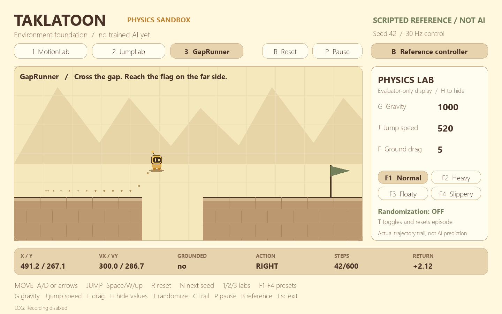

# TaklaToon — Physics Sandbox

A working Python + Pymunk + Pygame environment with a Gymnasium API, manual controls, transition recording, and deterministic replay. This is the first implemented project milestone. It does **not** include a trained AI, a world model, or an active-exploration algorithm yet.



## Start in VS Code

1. Open **this TaklaToon folder** in VS Code, not its parent folder.
2. Install the Microsoft Python and Python Debugger extensions (recommendations are included).
3. Install Python 3.11 or newer. The delivered build was tested using Python 3.13 on Windows.
4. Open a PowerShell terminal in this folder and run:

```powershell
powershell -ExecutionPolicy Bypass -File .\Setup.ps1
```

5. Run **Python: Select Interpreter** and select `.venv\Scripts\python.exe`.
6. Press **F5**, selecting **TaklaToon: Play sandbox** if prompted.

Or use the terminal directly:

```powershell
.\.venv\Scripts\python.exe run.py play
```

`Setup.ps1` creates an isolated local virtual environment and installs the package in editable mode. It does not change the machine-wide execution policy. Internet access is needed for the initial dependency download. Select the interpreter explicitly if VS Code remembers a previous selection.

### Alternative setup

```powershell
python -m venv .venv
.\.venv\Scripts\python.exe -m pip install -e ".[dev]"
.\.venv\Scripts\python.exe run.py play
```

## What is implemented

- **MotionLab:** accelerate and stop inside a marked target zone.
- **JumpLab:** jump onto a raised platform and reach a flag.
- **GapRunner:** cross a gap and reach a flag.
- Six discrete actions, known static geometry, and a 21-element numeric observation.
- Normal, heavy-gravity, floaty, and slippery presets.
- Seeded physics randomization and manual parameter changes at episode boundaries.
- Fixed physics stepping, independent of rendering frame rate.
- Success, fall, and time-limit outcomes with separate termination/truncation flags.
- Manual-play logging, headless collection, run inspection, verified replay, screenshots.
- A simple scripted reference controller, clearly labelled **not trained AI**.
- VS Code debugging profiles, editable installation, and automated tests.

## Controls

| Key | Action |
|---|---|
| A/D or left/right arrows | Move |
| Space, W, or up arrow | Jump; release before the next jump |
| R | Reset the same scenario and seed |
| N | Start the next seed |
| 1 / 2 / 3 | MotionLab / JumpLab / GapRunner |
| F1 / F2 / F3 / F4 | Normal / Heavy / Floaty / Slippery |
| G / J / F | Cycle gravity / jump speed / ground drag; resets the episode |
| H | Hide/show evaluator-only physics values |
| T | Toggle seeded randomization; resets the episode |
| C | Hide/show the **actual** trajectory trail |
| P | Pause/resume without advancing or logging simulation steps |
| B | Toggle the scripted reference controller |
| Esc or window close | Exit and flush logs |

The tabs, preset buttons, reset, pause, and reference-controller button are also clickable. The window can be resized. Physics remains in one fixed coordinate system.

## A short team-meeting demonstration

1. Start GapRunner and move/jump manually.
2. Press R and repeat. Observe the actual trajectory trail and velocity readings.
3. Press F2 to select heavy gravity. Attempt a similar jump and compare the result.
4. Press H to hide the evaluator's numeric settings. The future agent will never receive them.
5. Press 1 to demonstrate braking in MotionLab, then F4 for reduced drag.
6. Press B to show the simple scripted reference. Explain that it is a baseline, not the future AI.
7. Exit and inspect the recorded transitions.

Manual control timing is human-dependent. Use recorded actions and replay for exact comparisons. Different physics may require a different takeoff point. Physics values change only on reset in this version.

## Commands

All examples assume you are in the project folder and have run setup. They are implemented commands, not placeholders.

```powershell
# Start a chosen task
.\.venv\Scripts\python.exe run.py play --level motion --preset slippery

# Start the scripted meeting demo (NOT trained AI)
.\.venv\Scripts\python.exe run.py play --autoplay

# Manual play without writing logs
.\.venv\Scripts\python.exe run.py play --no-record

# Record randomized tasks headlessly
.\.venv\Scripts\python.exe run.py collect --episodes 10 --randomize --seed 42

# Record the scripted reference
.\.venv\Scripts\python.exe run.py collect --policy scripted --episodes 3 --output runs\reference

# Validate the Gymnasium API and the reference tasks
.\.venv\Scripts\python.exe run.py check

# Run the automated tests
.\.venv\Scripts\python.exe -m pytest

# Capture a real rendered frame
.\.venv\Scripts\python.exe run.py snapshot --level gap --advance 40 --output runs\screenshot.png
```

Once installed, `python -m taklatoon` or the `taklatoon` console command exposes the same interface. Run `python run.py --help` or `python run.py collect --help` for options. The `--max-steps` argument changes the per-episode interaction limit.

### Inspect and replay a run

The collector and manual game print the output folder. Substitute that folder here:

```powershell
.\.venv\Scripts\python.exe run.py inspect runs\reference
.\.venv\Scripts\python.exe run.py replay runs\reference --episode 0
.\.venv\Scripts\python.exe run.py replay runs\reference --episode 0 --headless
```

Replay reconstructs the episode from evaluator metadata and checks every recorded observation, reward, and terminal flag. An altered transition produces an error. Exact reproducibility is expected on the same pinned platform/library setup; do not assume bitwise reproducibility across all machines or Pymunk releases.

An actual three-episode reference run is included in `examples/sample-run`, along with `examples/sample-transitions.npz`. These are scripted baseline data, not learned-agent results. You can immediately inspect or replay that run:

```powershell
.\.venv\Scripts\python.exe run.py inspect examples\sample-run
.\.venv\Scripts\python.exe run.py replay examples\sample-run --episode 0
.\.venv\Scripts\python.exe examples\load_data.py examples\sample-run --output runs\training.npz
```

The NPZ exporter never reads evaluator metadata. It preserves episode IDs and separate termination/truncation flags. Use whole episodes/tasks for dataset splits. For a first kinematic model, a useful target is `next_observations[:, :4] - observations[:, :4]`; do not blindly assume every field is an independent motion target.

Output directories are created exclusively: choosing an existing `--output` directory fails rather than overwriting earlier work. Use a new name for each run.

## Logging contract

Each recorded run contains:

| File | Contents |
|---|---|
| `manifest.json` | Schema version, dependency versions, observation names, action IDs, policy label |
| `transitions.jsonl` | One record per real control decision |
| `episodes.csv` | Episode steps, return, success, and outcome |
| `evaluator.jsonl` | **Operator-only:** true physics, config, geometry, seed, and episode ID |

Transition records include `episode_id`, `step`, `observation`, `action`, `next_observation`, `reward`, `terminated`, `truncated`, `event`, `reward_components`, `sim_time`, and `control_source`. The last field distinguishes manual actions from the scripted reference when you toggle B during a session.

Do not feed `evaluator.jsonl` or `env.evaluator_metadata()` into a future agent. Hidden coefficients and preset names are absent from both the observation and Gymnasium `info`. The operator's visible physics panel does not change this numeric observation contract. Image-based agents would need a separate render mode without evaluator overlays.

A manual reset is summarized as `manual_reset`, and closing a running episode is `interrupted`. These do **not** fabricate terminal transitions. Use episode IDs to split sequences. A true fall or goal terminates the episode; a time limit truncates it. Further `step()` calls require a reset.

## Gymnasium integration

```python
import gymnasium as gym
import taklatoon  # Registers TaklaToon-v0.

env = gym.make("TaklaToon-v0", level="gap", preset="normal", randomize=True)
obs, info = env.reset(seed=42)
env.action_space.seed(42)
try:
    while True:
        action = env.action_space.sample()  # Replace with the future agent.
        next_obs, reward, terminated, truncated, info = env.step(action)
        # Store (obs, action, next_obs, reward, terminated, truncated).
        obs = next_obs
        if terminated or truncated:
            break
finally:
    env.close()
```

Use `render_mode="rgb_array"` for a `(900, 1440, 3)` uint8 screenshot, `"human"` for a window, and `None` for headless training. `render()` never advances the simulation. The interactive application owns keyboard input; an agent controls the same environment through `step()`.

See [OBSERVATIONS.md](OBSERVATIONS.md) for feature indices, units, and action rules.

## Physics and rewards

- World: 1200 × 600 simulation units, treated as pixels. Positive y points **up** in physics.
- Renderer flips y for screen coordinates.
- Control rate: 30 Hz. Physics rate: 120 Hz, four substeps per action.
- Character: fixed-rotation 32 × 44 collider, horizontal speed capped at 300 px/s.
- Jump strength is an initial vertical velocity in px/s (equivalent to impulse per unit mass).
- Horizontal acceleration is fixed. Air control uses a fixed reduced acceleration.
- Ground drag is the explicit exponential damping `vx *= exp(-drag * dt)` while grounded.
- Pymunk surface friction is zero. We do not mix it with the hidden drag coefficient.
- Jump actions are edge-triggered: holding a jump action does not repeatedly jump after landing.

The reward is `-0.01` per control step, plus signed distance-progress shaping, plus `+100` on success or `-20` on falling. Progress is `8 * (previous_absolute_goal_dx - current_absolute_goal_dx) / 1200`. This is a documented heuristic, not a claim of policy-invariant potential shaping. Reaching a goal pays once, then the episode ends.

MotionLab requires staying within 42 px of the target with `abs(vx) < 35` for six control steps. Other labs require a grounded arrival within 42 px of the flag. Falling below y = -80 terminates the episode. The default time limit is 600 actions (20 simulated seconds).

## Project layout and team ownership

```text
src/taklatoon/
  config.py       Validated settings and hidden physics presets
  levels.py       Task geometry and constants
  env.py          Pymunk physics and Gymnasium contract
  renderer.py     Pygame visuals; no physics stepping
  recording.py    Transitions, episode boundaries, evaluator metadata
  policies.py     Simple observable-state reference controller
  cli.py          Play, collect, inspect, replay, snapshot, check
tests/            Physics, API, logging, replay, and rendering checks
.vscode/          Ready-to-use launch and test settings
```

Suggested four-person split:

1. **Environment:** improve tasks and maintain observation/action compatibility.
2. **World model:** train a motion predictor from `transitions.jsonl`.
3. **Planning/exploration:** implement learned-model rollouts and probe selection.
4. **Evaluation/demo:** baselines, metrics, dataset splits, and replay evidence.

## Next project milestone

Collect a balanced set of movement, release, takeoff, airborne, and landing transitions. Split whole episodes and reserve physics combinations for testing. Train one small model to predict motion deltas before adding an ensemble. The future planner must use that learned model, not call this simulator to preview candidate actions.

The renderer's trajectory is observed history, not a learned prediction. The scripted controller is only a functional baseline. Its completion rates do not measure the proposed AI's adaptation ability.

## Troubleshooting

- **Module not found:** select the `.venv` interpreter and rerun `pip install -e ".[dev]"`.
- **Setup finds an old Python:** install a supported Python and create `.venv` with its explicit interpreter.
- **No jump after holding Space/action 3:** release the jump input before pressing again; air double jumps are disabled.
- **Goal not completing in MotionLab:** stop inside the target zone; driving through it is insufficient.
- **Run directory already exists:** choose a new output path.
- **No window during collect:** collection is headless by design. Use `play` or `replay` to view it.
- **Window appears slow on a heavily loaded machine:** rendering can slow wall-clock progress, but each logged action still advances the same simulated time.

## Dependencies and references

`pyproject.toml` declares supported ranges. `requirements-tested.txt` records the versions used during validation; it is a tested Windows environment snapshot rather than a guarantee for every Python/platform combination.

- [Pymunk API](https://www.pymunk.org/en/latest/pymunk.html)
- [Gymnasium environment contract](https://gymnasium.farama.org/api/env/)
- [Gymnasium custom environments](https://gymnasium.farama.org/introduction/create_custom_env/)
- [Pygame documentation](https://www.pygame.org/docs/)

